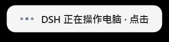
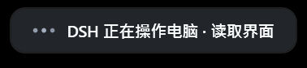

# dsh-computer-use

把 **ZCode 的 Computer Use（「电脑控制」）能力逆向重建为 DSH 插件**：让模型能看屏幕、
读应用界面、点按、输入、按快捷键、拖拽滚轮、走剪贴板——像人一样操作这台 Windows 电脑。

25 个工具与上游 Computer Use 工具面**同名**，参数语义、坐标纪律、`state_id` 元素寻址、
错误码语义都按上游契约重建；后端换成 Windows 上可用的原生实现
（长驻 `powershell.exe` + System.Drawing + UI Automation），不再依赖 ZCode 那份从未开源的
原生 Helper。

* 逆向复盘（过程 / 决策 / 验证强度 / 诚实的未竟项）：[docs/reverse-engineering.md](docs/reverse-engineering.md)
* 上游契约取证（432 处 `path:line` 证据）：[docs/zcode-cua-contract.md](docs/zcode-cua-contract.md)
* 原生桥协议（冻结接口）：[docs/native-protocol.md](docs/native-protocol.md)
* 模型面操作手册（随包技能）：[skills/computer-use/SKILL.md](skills/computer-use/SKILL.md)

---

## 1. 它从哪来：一次真实的逆向

上游 ZCode 的开源仓库里 Computer Use 是**不可用占位包**
（`packages/zcode-cua/index.js` 里 `createComputerUseRuntime()` 直接返回
"Computer Use is not available in this build."），三个必需资产
（`docs/computer-use.md`、`scripts/computer-use-client.mjs`、`skills/computer-use/SKILL.md`）
也不在仓库里。git 只有三个提交，真实实现从未进过历史。

能重建，是因为契约全留下了：

| 留下的东西 | 位置 |
|---|---|
| 25 个工具名 | `packages/ui/src/ToolCallBlocks/renderers/cuaSummaryMessages.ts` |
| 元素寻址/坐标/`action_sent` 等模型面纪律 | `apps/zcode-cli/packages/node-repl-host/src/tool-contract.ts` |
| broker 私有传输协议（JSON 行 + `id/token/method/input/context`） | `node-repl-host/src/cua-bridge.ts`、`cua-broker.ts` |
| 稳定错误码（`element_unavailable`/`foreground_required`/…） | `packages/zcode-cua/broker.js` |
| `state_id`、`screenshot_display.bounds`、图像配额、`_meta` 关联键 | `core/src/tool/executor/result-display.ts`、`packages/zcode-cua/frame-contract.*` |
| 官方插件定义、版本、seed 资产清单 | `bootstrap/src/app/official-plugin-definitions.ts` |

**没**留下的：真实 SDK 的方法签名、Windows Helper 的 RPC、AX 角色映射表
（`ROLE_TO_KIND = {}`）、以及那三个资产文件本身。这些只能重建，见
[docs/zcode-cua-contract.md](docs/zcode-cua-contract.md) 的「未解之谜」与「重建对照表」。

---

## 2. 架构

```
┌──────────────────────── DSH 进程 ────────────────────────┐
│  src/index.js       插件入口：读配置、注册工具、自装技能  │
│  src/tools.js       25 个工具定义 → 参数映射/信封/降级    │
│  src/schema.js      官方同语义的参数校验 + 无损宽化        │
│  src/format.js      模型面信封、app-associations 元数据   │
│  src/bridge.js      NDJSON 客户端：串行队列/超时换进程/自愈│
└───────────────────────────┬──────────────────────────────┘
                            │ stdin/stdout NDJSON（dsh-cua/1）
┌───────────────────────────▼──────────────────────────────┐
│  src/native/cua.ps1   长驻 Windows PowerShell 5.1 进程     │
│    SetProcessDPIAware → 截图/窗口/UIA/输入/剪贴板/启动应用 │
└──────────────────────────────────────────────────────────┘
```

几个刻意的选择：

* **不走 MCP、不用 `defineTool`。** `@deepseek-ai/dsh-tools` 在插件侧解析不到
  （实测 `createRequire(profile/index.js).resolve()` 失败），因此按注册表接受的
  **原始 JSON Schema** 直接 `ctx.tools.register()`——这正是 MCP 服务器注册工具的方式。
  参数校验由 `src/schema.js` 按官方子集语义补上（文案逐字对齐，测试里与官方实现对比）。
* **PowerShell 而不是原生 addon。** Windows 上 `System.Drawing` + `UIAutomationClient`
  在 5.1 宿主开箱可用；不需要随包发布二进制，也不受 DSH 内部 koffi 影响。
* **`SetProcessDPIAware()` 是必须的。** 实测 150% 缩放下不调用它，截图是 1707x1067
  而 UIA/窗口坐标是 2560x1600，两个坐标空间不一致，整个 Computer Use 的坐标映射都会错。
* **超时即换进程。** 协议是串行的；超时后无法判断迟到响应属于哪条请求，因此直接 kill
  并在下次调用时重启，绝不猜测归属。

---

## 3. 安装

插件是普通 npm 包 + 一份 cordis patch，两种装法：

### 3.1 App 内从路径安装（推荐）

DSH 的「插件」页 → 从路径安装 → 选择本目录
（本仓库 clone 后的目录），然后**重启 DSH**。

### 3.2 手改 profile

编辑 `<dsh home>/profiles/<profile>/package.json`
（Windows 默认 `%USERPROFILE%\.dsh\profiles\desktop\package.json`）：

```jsonc
"dependencies": {
  "dsh-computer-use": "link:E:/OpencodeProject/Project/DSH-Plugin/dsh-computer-use"
},
"dsh": {
  "profile": {
    "bundles": [
      // …其它 bundle
      "dsh-computer-use"     // ← 加入这里，它的 cordis.patch.yml 才会被应用
    ]
  }
}
```

然后在 profile 目录执行 `pnpm install`，重启 DSH。
`cordis.patch.yml` 只做一件事：把本插件的宿主端入口 insert 进 profile 树。

### 3.3 验证装好了

六层验证，全部可重复执行（数值是本机实测结果）：

```powershell
cd <本仓库目录>

node tools/ref-extract-validator.mjs   # 从 app.asar 提取官方实现到 .ref/（开发期依赖，可选）
npm test                               # 95 通过：单元 + 与官方实现的等价性交叉验证（含访问闸门矩阵）
npm run smoke                          # 147 通过：原生后端 24 个协议方法（真机）
npm run e2e                            # 74 通过：完整链路端到端（真机，含访问闸门验收）
npm run indicator:smoke                # 54 通过：操作指示器三条硬性质（真机，见下）
npm run verify:registry                # 10 通过：真实 cordis + 真实 dsh-tools 注册表加载
npm run verify:in-dsh                  # 14 通过：真实 DSH 里让模型自己点一次按钮
node tools/install-skill.mjs status    # 技能是否已进用户技能根
```

> `npm run verify:in-dsh` 需要**模型账号可用**。若 provider 返回 `402 Insufficient
> Balance`，这一层会因为「模型压根没跑起来」而全红——那不是插件的失败，看日志里的
> `error.code === "QUOTA"` 就能区分。

`npm run indicator:smoke` 的两条判据（退出码 `0` 通过 / `1` 产品失败 / `2` 环境不稳定无法判定）：

* **首选，与背景无关**：`PrintWindow` 让窗口把自己画进抓图 DC——指示器必须整张全黑（拒绝渲染），
  而同构造、无 affinity 的孪生窗必须正常画出卡片。实测 `indicator distinct=1 avgLuma=0` /
  `twin distinct=45 avgLuma=130`。
* 旁证，逐像素：显示 vs 隐藏截同一区域要求逐像素一致且 PNG 字节相同，并用「目击区」
  排除「背景自己在变」。这条要求该区域静止；你屏幕上若跑着全屏游戏/视频，工具会诚实报
  **INCONCLUSIVE** 而不是 FAIL。

`verify:in-dsh` 是最强的一层：在**真实 DSH** 里跑一个受控任务
（`dsh --profile <p> --json`，任务经 stdin 送入），让模型自己加载技能、读界面、
按 `element_index + state_id` 点我们自己的 WPF 夹具按钮；**结论不采信模型汇报**——
脚本跑完后用原生后端独立再读一次窗口标题，只有真的变成 `CLICKED:1` 才算通过。
它需要一个独立验证 profile（不碰 `desktop`）：

```powershell
# 1) 在 dsh 源码 checkout 里用出厂 headless 模板建验证 profile
pnpm dsh cu-verify --from-default-profile headless
# 2) 把插件装进它（DSH_PROFILE 决定目标 profile）
$env:DSH_HOME="$env:USERPROFILE\.dsh"; $env:DSH_PROFILE='cu-verify'
node tools/install-plugin.mjs --apply --install
# 3) 跑
node tools/verify-in-dsh.mjs --profile=cu-verify
```

也可以用带备份的安装器一步装进 profile（默认只预览，不改任何东西）：

```powershell
node tools/install-plugin.mjs                    # dry-run：打印将要发生的改动
node tools/install-plugin.mjs --apply --install  # 备份 + 写入 + pnpm install
node tools/install-plugin.mjs --rollback         # 从备份恢复
```

装好并重启 DSH 后，在会话里让模型调 `request_access`：它会回报平台、屏幕、DPI 感知、
显示器数量与后端可用性。**这是最直接的端到端确认。**

---

## 4. 配置

配置读 `<dsh home>/plugins/dsh-computer-use/config.json`（不存在则用默认值），
也可以在 profile 的插件条目里用 `config:` 覆盖（内联优先）。损坏/缺字段时逐字段回退默认值。

| 字段 | 默认 | 含义 |
|---|---|---|
| `enabled` | `true` | 关掉后一个工具都不注册 |
| `tools` | `"native"` | `native` = 25 个独立工具；`single` = 一个 `computer_use`（带 `action`），省 schema token |
| `warmup` | `true` | 加载时预热后端；关掉则首次调用才拉起（多等约 1-2 秒冷启动） |
| `installSkill` | `true` | 把随包技能装到 `<dsh home>/skills/computer-use/`（带所有权标记，不覆盖用户自写版本） |
| `accessMode` | `"auto"` | 谁能调用电脑操控：`auto` 全自动 / `ask` 每次弹审批 / `off` 禁用（见 §5.4） |
| `allowSubagents` | `false` | 是否允许**子代理**调用电脑操控（默认关闭：子代理动用户鼠标键盘时用户看不见也难喊停） |
| `indicator` | `true` | 是否显示屏幕最前端的「DSH 正在操作电脑」浮层（见 §5.5） |
| `indicatorLocale` | `"auto"` | 浮层文案语言：`auto` / `zh-CN` / `en-US` |
| `indicatorShowAction` | `true` | 文案后是否带上当前动作（「· 正在点击」） |
| `indicatorAutoHideMs` | `30000` | 无操作活动多久后自动隐藏（兜底，防止浮层滞留） |
| `requestTimeoutMs` | `30000` | 单次调用默认超时 |
| `screenshotTimeoutMs` | `60000` | 截图/取界面树超时 |
| `startupTimeoutMs` | `20000` | 等待后端 ready 上限 |
| `maxRestarts` | `3` | 后端崩溃后自动重启上限，超出后报明确不可用原因 |
| `screenshotMaxWidth` | `1600` | 模型可见截图长边上限（0 = 不缩放） |
| `screenshotMaxBytes` | `524288` | 单张截图字节预算，超出按 png→jpeg→更小栅格降级重拍 |
| `screenshotFormat` / `screenshotQuality` | `"png"` / `80` | 默认编码与 jpeg 质量 |
| `saveFrames` / `keepFrames` | `true` / `40` | 截图落盘到 `plugins/dsh-computer-use/frames/`，只保留最新 N 张 |
| `debug` | `false` | 把原生后端的 stderr 诊断写进 DSH 日志 |

```jsonc
// 示例：省 token 的单工具模式 + 更小的截图
{ "tools": "single", "screenshotMaxWidth": 1280, "screenshotFormat": "jpeg" }
```

---

## 5. 工具面（25 个，与上游同名）

| 分组 | 工具 |
|---|---|
| 环境与观察 | `request_access` `list_apps` `list_windows` `get_app_state` `screenshot` `zoom` |
| 启动与聚焦 | `open_application`（聚焦窗口走 `list_windows` + 前台语义） |
| 鼠标 | `left_click` `double_click` `triple_click` `right_click` `middle_click` `mouse_move` `left_click_drag` `scroll` |
| 键盘 | `type` `key` `hold_key` |
| 元素动作 | `set_value` `select_text` `perform_action` |
| 等待与剪贴板 | `wait` `read_clipboard` `write_clipboard` |
| 收尾 | `stop_computer_control` |

**两条核心纪律**（模型侧由 `skills/computer-use/SKILL.md` 承载）：

1. **元素目标优先**：`get_app_state` 拿 `state_id` + `elements[*].index`，
   动作时原样回传。界面一变 `state_id` 就 stale，重新读一次。
2. **坐标是栅格像素**：`screenshot` 返回的图片内部的像素，不是物理屏幕像素；
   要直接用物理像素得显式 `space:"screen"`。窗口/元素 `bounds` 不得当栅格坐标用
   （上游 `tool-contract.ts` 的原文警告）。

细节、参数表、错误恢复、Windows 限制见 [skills/computer-use/SKILL.md](skills/computer-use/SKILL.md)。

### 5.5 操作指示器（屏幕最前端那一条）

只要有 Computer Use 动作在跑，屏幕顶部正中就会出现一张小卡片：**「DSH 正在操作电脑 · 正在点击」**
（中文/英文随环境，可在配置里固定）。行为照上游 ZCode 的 `windowsCuaOperationIndicator`：





> 这两张图是**真实生产窗口**的 `PrintWindow` 抓取（不是另画的示意图）：
> 生产浮窗**故意**不进截图（见下表第三行），所以日常截图永远拍不到它；
> 文档预览靠一个只为文档/调试存在的开关 `DSH_CUA_INDICATOR_CAPTURABLE=1` 生成，
> 由 `node tools/indicator-preview.mjs` 复现。

| 性质 | 为什么 |
|---|---|
| **点击穿透**（`WS_EX_TRANSPARENT`） | 用户点到浮层所在位置时，事件落到它下面的窗口，不会被拦住 |
| **不抢焦点**（`WS_EX_NOACTIVATE` + `ShowActivated=false`） | 否则键盘注入会打进浮层，Computer Use 直接失效 |
| **不出现在截图里**（`SetWindowDisplayAffinity(WDA_EXCLUDEFROMCAPTURE)`） | 否则模型每张截图都被自己的浮层污染，既贵又误导 |
| 顶部居中（鼠标所在显示器的工作区，距顶 12px） | 与上游一致；多屏时跟着鼠标走 |
| 三个脉冲圆点 + 140ms 进场 / 120ms 离场 | 与上游一致 |
| 可见期间每秒重申置顶 | 上游用 Electron 的 `screen-saver` z-band；WPF 只有 `Topmost`，不重申会被后创建的置顶窗口盖住 |
| **30s 无活动自动隐藏** | 兜底边界：浮层声称「正在操作电脑」，滞留就等于撒谎 |
| 回合结束（`agent/status` → idle）立即收起 | 上游的 turn 终态语义；事件收不到时由 30s 兜底保证 |
| `stop_computer_control` 立即收起 | 它表达的是「控制权已交还」 |
| 隐藏失败就销毁窗口 | 上游同款底线：宁可不显示，也不能假装在显示 |

浮层本身是 `src/native/indicator.ps1`（长驻 WPF 进程，插件加载时预热以免第一次动作亮得迟），
Node 侧控制器在 [src/indicator.js](src/indicator.js)。**指示器的任何失败都不影响桌面操作**——
它只是可见性保证，坏掉只会记一条日志。真机核验（点击穿透 / 不抢焦点 / 不进截图）在
`npm run indicator:smoke`。

---

### 5.4 访问控制：谁能调用电脑操控

Computer Use 真的会动用户的鼠标键盘，所以**必须有一个用户随手能关的闸门**。输入框那一行
（紧挨「完全权限」芯片）有一个 **「🖱 电脑操控：全自动」** 按钮，点开是一个菜单：

| 设置 | 选项 | 含义 |
|---|---|---|
| 允许子代理调用 | 开 / 关（默认关） | 关掉后**子代理一律拒绝**——它们跑在用户看不到的上下文里，一次委派里可能反复调用 |
| 模式 | **全自动** | 有需求就直接执行 |
| | **需要询问** | 每次调用前弹出 DSH 原生审批面板，只有用户点「允许一次」才执行 |
| | **禁用** | 完全关闭：主 Agent 与子代理都拿不到执行权（连截图等只读动作也不放行） |

**闸门在宿主侧、每次调用都判**（[src/access.js](src/access.js)），所以：

* 设置改完**立即生效**，不需要重启 DSH；
* 界面上禁用了、模型照样能调——这种情况不存在：执行权压根到不了后端；
* 判定不出来的一律**拒绝**（fail-closed），并且被拒绝的调用**不会点亮操作指示器**
  （屏幕上什么都没发生却显示「DSH 正在操作电脑」就是在骗人）。

设计上的两个取舍，写在这里以免被当成 bug：

1. **模式是「插件级」的，不是「每会话」的**。DSH 的会话投影（permission preset 用的那套）
   需要 schema 与事件 reducer，而本插件刻意零依赖，所以设置落在
   `<dsh home>/plugins/dsh-computer-use/config.json`，全局生效。
2. **「需要询问」依赖 DSH 的权限预设**。若当前预设是「完全权限」（不询问那档），
   `approval/request` 会被直接判为 `rejected`——于是电脑操控**全部被拒**。
   这是刻意的 fail-closed，错误消息里会告诉用户怎么改（切权限预设，或把模式改回「全自动」）。

也可以用命令改（GUI 菜单提交的就是它）：

```
/computer-use                          # 看当前设置
/computer-use mode ask                 # 需要询问
/computer-use mode=off subagents=on    # 也可以一次提交两个字段
```

**重启后自查（四步，每一步都有可核验的判据）**：

1. 输入框那一行、紧挨「完全权限」芯片右侧应出现 `🖱 电脑操控：<模式>`；
   看不到就先确认 `%USERPROFILE%\.dsh\profiles\desktop\package.json` 里有本插件、且重启后没有加载报错。
2. 点开菜单选「禁用」，然后让模型做个 GUI 动作：应当**报 `CUA_DISABLED` 并明确说桌面没有任何变化**，
   而屏幕上不会出现「DSH 正在操作电脑」浮层。
3. 同时看 `request_access` 的输出：应当带 `access_mode="off" subagents="blocked"`
   （这条是运行时可自查的凭据，界面改了设置这里立刻能看出来）。
4. 在菜单里改回「全自动」，同一动作应当正常执行；`<dsh home>/plugins/dsh-computer-use/config.json`
   里应出现 `"accessMode": "auto"`（设置确实落盘，不只是内存态）。

训练/调试时若怀疑「设置了但没生效」，按 3 → 4 的顺序看：`request_access` 报的是宿主**当前**值，
`config.json` 是**磁盘**值；两者不一致说明命令没走通（看日志里有没有
`/computer-use` 注册失败的警告）。

---

## 6. 与上游的差异

| 上游 ZCode | 本插件 |
|---|---|
| 原生 Helper（macOS `.app` / Windows dev helper）+ Unix socket + native addon | 长驻 `powershell.exe` + NDJSON（[docs/native-protocol.md](docs/native-protocol.md)） |
| 25 个动作是 `node_repl` 的私有 capability，模型只见 `js` 一个工具 | 直接注册为 DSH 工具（DSH 无等价 JS kernel 桥）；`tools:"single"` 可退回单工具形态 |
| macOS 辅助功能/屏幕录制授权状态机（`platform` 硬编码 `"darwin"`） | Windows 无此模型；`request_access` 返回平台正确的环境自述 |
| PiP 会话、操作胶囊、内联截图渲染 | 不做 UI；截图作为原生图像块随结果附带并落盘 |
| 项目级授权键 `zcode:permission-capability:official_cua` + capability group 双重校验 | 未实现（DSH 的权限模型不同）；本插件默认在 `enabled: true` 时全量暴露 |

`wait` 的时长参数两种写法都收（`duration` 秒 / `duration_ms` 毫秒），
因为上游用的是秒、而本插件的协议是毫秒——这是刻意的兼容层，不是笔误。

---

## 7. 已知限制

* **UIPI（提权窗口）**：DSH 以普通权限运行时，注入的输入到不了提权窗口
  （任务管理器、管理员安装程序）。症状是「调用成功但界面无反应」。
  缓解：改用 `perform_action`/`set_value` 这类 UIA 动作，或让 DSH 以管理员启动。
* **UWP / 商店应用**：窗口属主常是 `ApplicationFrameHost`，`appKey` 可能带 pid 后缀。
* **最小化窗口**：没有几何信息，先聚焦还原再操作。
* **自绘界面**（Electron 内部 canvas、游戏、远程桌面）：元素树可能为空，只能截图 + 坐标。
* **仅 Windows**：`src/native/cua.ps1` 依赖 Windows PowerShell 5.1 与 UI Automation。
  其它平台会得到明确的 `BACKEND_UNAVAILABLE` 而不是静默失败。
* **脚本执行策略**：组策略禁止 `powershell.exe` 执行脚本时后端起不来，`request_access` 会说明原因。

---

## 8. 开发注意

* **`src/native/cua.ps1` 必须带 UTF-8 BOM。** Windows PowerShell 5.1 会把无 BOM 的
  UTF-8 当 ANSI 读，中文注释会破坏语法解析并报出与实际位置不符的错误。
  改完用 `tools/native-smoke.mjs` 或 §3.3 的命令跑一遍。
* **不要用 PowerShell 的 `Set-Content` 重写 JS/JSON 源文件。** 5.1 下
  `Get-Content -Raw` 会按 ANSI 解码，再 `Set-Content -Encoding UTF8` 写回就把
  UTF-8 中文注释变成乱码（本项目已经踩过一次，只能整文件重写恢复）。
  改文件用编辑工具，别用字符串替换管道。
* **`.ref/`** 是开发期从 DSH 的 `app.asar` 提取出来的官方实现（不随包发布），
  用来在测试里用**官方代码**交叉验证我们的 schema 与技能 frontmatter：

  ```powershell
  node tools/ref-extract-validator.mjs     # 提取 dsh-tools / yaml / dsh-skill*
  npm run test                            # 提取后，跨验证用例从 skip 变成实跑
  ```

  没有 `.ref/` 时相关断言自动 skip，其余测试照常跑。
* **`tools/probe-native.ps1` / `tools/probe-dpi.ps1`** 是最初的四原语与 DPI 可行性探针，
  保留下来作为「这台机器到底能不能跑」的最小复现。

---

## 9. 目录

```
src/index.js        插件入口（注册/配置/技能自装/生命周期）
src/tools.js        25 个工具定义与参数映射
src/schema.js       JSON Schema 子集校验（与官方同文案）+ 无损宽化
src/format.js       模型面信封、错误提示、app-associations 元数据
src/bridge.js       NDJSON 客户端（串行/超时换进程/重启上限）
src/config.js       配置与路径约定
src/access.js       访问闸门（模式/子代理判定，纯函数，含命令参数解析）
src/skill.js        技能自安装（带所有权标记）
src/indicator.js    操作指示器控制器（30s 兜底隐藏、失败不冒泡）
lib/client.js       浏览器半：输入框那一行的「电脑操控」按钮与设置菜单
src/native/cua.ps1  Windows 原生后端（协议见 docs/native-protocol.md）
src/native/indicator.ps1  置顶操作指示器浮窗（协议见 docs/indicator-protocol.md）

skills/computer-use/SKILL.md   模型面操作手册
docs/native-protocol.md        冻结的原生桥协议
docs/indicator-protocol.md     冻结的指示器协议（点击穿透/不抢焦点/不进截图）
docs/indicator-preview.png     指示器预览（浅色，生产窗口的 PrintWindow 抓取）
docs/indicator-preview-dark.png  指示器预览（深色）
docs/zcode-cua-contract.md     上游契约逆向取证（带行号证据）
docs/reverse-engineering.md    逆向复盘：决策、验证强度、未竟项

test/                          95 个单测（schema / bridge / tools / plugin / skill / indicator / access / client）
test/helpers.mjs               假子进程、假 ctx、官方实现加载器

tools/native-smoke.mjs         原生后端协议冒烟（真机，147 断言）
tools/e2e.mjs                  完整链路端到端（真机，66 断言，含指示器与进程清场）
tools/e2e-fixture.ps1          端到端注入目标：我们自己的 WPF 窗口（零用户数据风险）
tools/indicator-smoke.mjs      指示器真机核验（穿透 / 焦点 / 不进截图，含 INCONCLUSIVE 判定）
tools/indicator-preview.mjs    生成指示器预览图（靠 DSH_CUA_INDICATOR_CAPTURABLE=1）
tools/capture-window.ps1       PrintWindow 窗口抓图（DPI 感知，只取窗口自身像素）
tools/probe-indicator.mjs      控制器 ↔ 脚本的接口对齐探针（生产代码路径）
tools/probe-fixture-uia.mjs    夹具窗口的 UIA 树导出（用来发现 WinForms 只暴露 Pane）
tools/verify-real-registry.mjs 真实 cordis + 真实 dsh-tools 注册表加载验证
tools/verify-in-dsh.mjs        真实 DSH 里让模型自己点按钮，并用独立观察核验结果
tools/ref-extract-validator.mjs 从 app.asar 提取官方实现到 .ref/（开发期）
tools/asar.mjs                 无依赖 asar 读取器
tools/install-plugin.mjs       带备份/回滚的 profile 安装器（默认 dry-run）
tools/install-skill.mjs        技能安装 CLI（status / install / uninstall）
tools/probe-native.ps1         「这台机器能不能跑」四原语探针
tools/probe-dpi.ps1            DPI 感知与坐标空间一致性探针
tools/spike-indicator.ps1      指示器可行性尖刺（置顶/穿透/不进截图）
tools/probe-cached-value.ps1   UIA 缓存视图下 ValuePattern 读取路径探针
tools/probe-fixture-steps.mjs  观察 → set_value → 观察 的值读取诊断
tools/kill-backends.mjs        清理/盘点遗留后端与指示器进程（并记录「查询自匹配」这个坑）
```

---

## 11. 验证抓到的真 bug（留档，避免回退）

端到端、「官方实现交叉验证」与「真实 DSH 里跑模型」三种手段合计抓出过四个单测测不到的缺陷，
修复都带了回归测试：

1. `URL` 直接交给 `spawn` → PowerShell 收到 `file:///…` 直接退出（`src/bridge.js`）。
2. `Convert-Str` 把 UIA 缓存包装的**合法字符串**当成 `System.__ComObject` 丢弃
   → `elements[].value` 恒为空，模型读值通道断掉（`src/native/cua.ps1`）。
3. 拖拽的层间协议不一致：协议规定 `from`/`to` 对象，工具层发了扁平键（`src/tools.js`）。
4. **返回值不是无损 JSON**：点击等结果的 `app`/`state_id` 在坐标路径上是 `undefined`，
   DSH 直接判整次调用失败（`tool "left_click" returned invalid output: value is not
   lossless JSON`）——**而桌面已经被真的点过了**。现在在注册收口处统一清洗
   （`toLosslessJson`），并在单测里对全部 25 个工具逐次跑官方无损校验。

细节见 [docs/reverse-engineering.md](docs/reverse-engineering.md) §4。

---

## 12. 许可与归属

本仓库代码以 **MIT** 发布，见 [LICENSE](LICENSE)。

第三方归属、逐字摘录的来源与许可、以及「哪些目录不入库」的说明，集中写在
[NOTICE.md](NOTICE.md)，其中三条要点：

* 本项目是**独立第三方插件**，与 DeepSeek Harness、ZCode / Z.ai 无隶属或背书关系。
* [docs/zcode-cua-contract.md](docs/zcode-cua-contract.md) 含对 ZCode 开源仓库
  （**Apache-2.0**）的路径/行号引用与少量逐字摘录，用于接口重建取证并已署名；
  本仓库**不含**上游任何源代码、二进制或资产（其 Computer Use 在开源版里本身就是占位实现）。
* `.ref/`（从本机已安装的 DSH 应用提取的 `@deepseek-ai/*`）仅供本地交叉验证，
  已在 `.gitignore` 中排除，**不应提交**。
